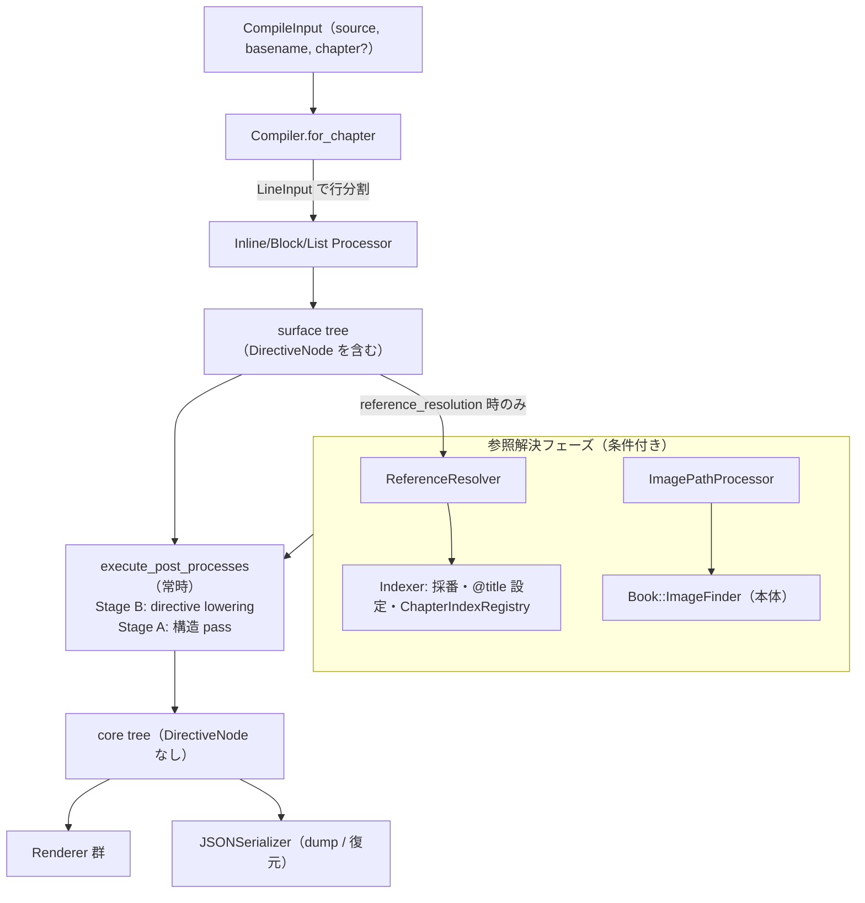
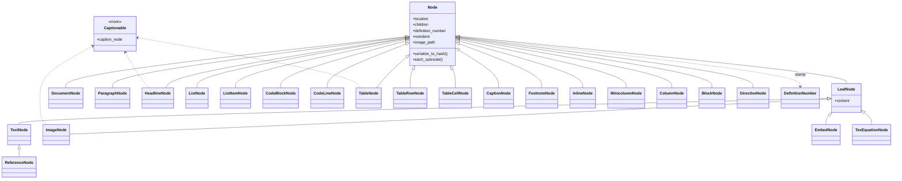
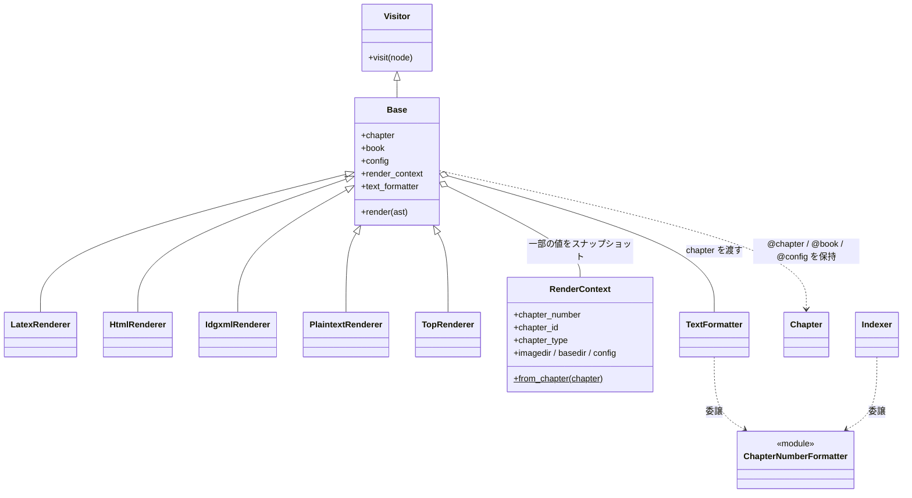
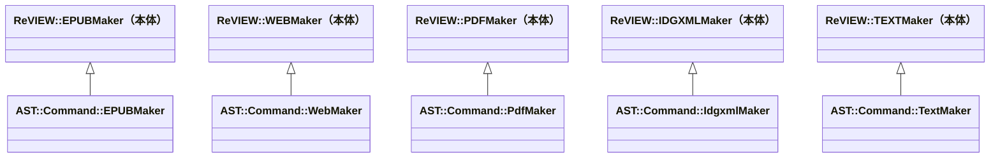

# review-ast アーキテクチャ

本書は review-ast の全体構造と、Re:VIEW 本体(released gem `review`)との関係を説明する。
AST の意味論そのものは `doc/ast-semantics.ja.md`、個々の設計判断は `doc/design-improvements.ja.md`
を参照。ここでは「どのクラスが何を担い、本体とどこで、どの程度密に接するか」に絞る。

## 1. 全体像: 本体と review-ast の関係

review-ast は本体 `review` gem とは別の gem であり、依存は一方向(review-ast → 本体)である。
ただし「疎結合」ではない。結合の実態は次のとおり。

- 本体クラスへの monkey patch は 0 件、本体から review-ast への逆参照も 0 件。
- 一方で、本体との結合は継承・instance variable・既存メソッドの override を通じて密である。
  - Indexer は `Book::Chapter` の `@title` を直接書き換える(`instance_variable_set`)。
  - ReferenceResolver は `book.chapter_index` / `book.contents` / `Book::Bib` を直接読む。
  - Renderer は `@chapter` / `@book` / `@config` を保持し、章タイトル・前後章・`WEBTOCPrinter`
    を直接参照する。
  - 各 maker は本体 maker を継承し、`build_chap` / `build_body` / `make_input_files` などの
    内部メソッドと `@converter` / `@book` / `@config` に依存する。

したがって本書の主軸は「patch がないから独立」ではなく、「patch はしないが、継承と内部状態への
依存を伴う限定的な差し替えで本体に噛み合っている」である。本体を patch しない代わりに、本体の
内部構造(メソッド名・instance variable・制御フロー)へは強く依存しており、本体更新時の追随
リスクはそこに集中する。

```mermaid
flowchart LR
  subgraph AST["review-ast gem"]
    direction TB
    Compiler["Compiler / Processors"]
    Nodes["AST ノード群"]
    Renderers["Renderer 群"]
    Makers["AST::Command::* Maker"]
  end

  subgraph Review["review gem 本体"]
    direction TB
    LineInput["LineInput（字句入力）"]
    Book["Book::Base / Chapter / Part / Bib / ImageFinder"]
    Services["SecCounter / I18n / WEBTOCPrinter / Template / Configure"]
    LegacyMakers["EPUBMaker / WEBMaker / PDFMaker / IDGXMLMaker / TEXTMaker"]
  end

  Compiler -->|字句入力| LineInput
  Compiler -->|@title 書換・index 参照| Book
  Renderers -->|採番・目次・ロケール| Services
  Renderers -->|title / 前後章 参照| Book
  Makers -->|継承・内部 override| LegacyMakers

  Review -. 逆参照なし・patch なし .-> AST
```

貫く設計上の狙いは「AST 契約に現れるデータ型は review-ast が所有し、契約に現れない環境依存の
サービスは本体を再利用する」。ノード・番号・パス・コンテキストは review-ast が所有する。字句入力・
画像探索・ロケール・テンプレート・組版・梱包は本体を再利用する。ただしこの線引きは AST の
データ型についての方針であって、後述のとおり実装レベルでは本体の内部状態への依存が残っている。

## 2. 本体との界面

「契約」として意図された接点は次の3つ(`CompileInput`・`RenderContext`・maker の converter 差し替え)
だが、実際にはそれらの外側に、本体の内部へ直接触れる依存が併存している。両方を挙げる。

意図された契約:

| 接点 | 使う本体 | review-ast 側の窓口 | 役割 |
|---|---|---|---|
| コンパイル入口 | `ReVIEW::LineInput` | `CompileInput` → `Compiler` | ソース文字列を行入力へ流す(字句解析自体は AST 独自実装) |
| レンダラ入力 | `Book::Chapter`(サービスハンドル) | `RenderContext` | 章番号/id/型/パス/config を値として一部スナップショット |
| maker 層 | 本体 maker(継承) | `AST::Command::*Maker` | 梱包・組版を継承し、章の描画を AST に差し替える |

契約の外側にある直接依存(追随リスクの主因):

| 箇所 | 依存先 | 内容 |
|---|---|---|
| Indexer | `Book::Chapter#@title` | 章タイトルを `instance_variable_set` で直接書き換える |
| ReferenceResolver | `book.chapter_index` / `book.contents` / `Book::Bib` | 相互参照・書誌の解決で本体 index を読む |
| Renderer::Base | `@chapter` / `@book` / `@config` | 生の本体オブジェクトを保持(`RenderContext` はその一部の写し) |
| HtmlRenderer#post_process | `chapter.title` / `next_chapter` / `prev_chapter` / `WEBTOCPrinter` | フルページ生成で本体を直接参照 |
| 各 maker | 本体 maker の内部メソッド・instance variable | `build_chap` 等を override(下表) |

## 3. コンパイルパイプライン

`Compiler#compile_to_ast(input)` の制御フローは次の順である。

1. `build_ast_from_chapter` — surface tree(`DirectiveNode` を含む)を作る。
2. `reference_resolution` が真のときのみ、`resolve_references` と `resolve_image_paths` を走らせる。
   参照解決は内部で Indexer を呼び、`definition_number` を stamp し、章 `@title` を設定し、
   `ChapterIndexRegistry` を作る。画像パス解決は `Book::ImageFinder` を使う。
3. `execute_post_processes` — directive lowering(Stage B)と構造パス(Stage A)。常時走る。
4. core tree(`DirectiveNode` なし)を返す。

つまり採番と参照解決は directive lowering / 構造パスより前に行われる。そして Indexer は
ReferenceResolver の中で呼ばれるため、`reference_resolution: false`(index 専用ビルド等、木を
捨てる用途)の木には `definition_number` の stamp が付かない。



`reference_resolution: false` のときは Resolve フェーズ全体がスキップされ、採番も行われない点に注意。

## 4. ノードモデル

すべてのノードは `Node` を基底とし、子を持たない内容ノードは `LeafNode` を経由する。
シリアライズは各ノードの `serialize_properties` / `deserialize_from_hash` に一元化され
(かつての `to_h` 系は撤去)、横断的フィールド(`definition_number` / `noindent` /
`image_path`)は基底が付与する。

次の図は代表的なノードのみを示す抜粋である(実際にはこのほか `DocumentNode` / `FootnoteNode` /
`CaptionNode` / `BlockNode` / `TableRowNode` / `TableCellNode` などがある。全ノードの一覧と
意味論は `doc/ast-semantics.ja.md` を参照)。



`Captionable`(caption を持てる mixin)は上図の `HeadlineNode` / `TableNode` / `ImageNode` の
ほか、`CodeBlockNode` / `MinicolumnNode` / `ColumnNode` / `BlockNode` / `TexEquationNode` にも
include される(計8クラス)。`FootnoteNode` は `Node` の直接のサブクラスで、`LeafNode` ではない。

型判別子(`inline_type` / `code_type` / `table_type` / `minicolumn_type` など)は
コンストラクタで Symbol に正規化され、fresh コンパイルと deserialize で表現が一致する。

## 5. レンダラ

各 renderer は `ReVIEW::AST::Visitor` を継承し、core tree を訪問して形式別文字列を作る。
renderer は本体モデルから隔離されてはいない。`Base` は生の `@chapter` / `@book` / `@config` を
保持し、`TextFormatter` にも `chapter` を渡す。`RenderContext` はそこから一部の値
(番号/id/型/パス/config)を一度だけ写し取ったスナップショットであって、本体オブジェクトの
代替ではない。とくに `HtmlRenderer#post_process` は章タイトル・前後章・`WEBTOCPrinter` を
本体から直接参照してフルページを組む。



`RenderContext.from_chapter(chapter)` は `Book::Chapter` から number/id/型/パス/config を写し取る。
番号整形の分類は `RenderContext.chapter_type`、整形本体は `ChapterNumberFormatter`(AST 中立)で、
compile 側(Indexer)と render 側(TextFormatter)が共有する。ただし前述のとおり renderer は
`RenderContext` に載らない情報(章タイトル・前後章・目次)を本体から直接得ており、`RenderContext`
は隔離の完成形ではなく段階的な切り出しである。

## 6. maker 層(出力生成)

出力(EPUB/Web/PDF/IDGXML/Text)は本体 maker を継承して作る。「converter だけの差し替え」で
済むのは EPUB と Web のうち converter に関わる部分だけで、実際には maker ごとに override する
内部メソッドが異なる。継承・override 前提のため、本体 maker の内部構造が変わると追随が必要になる。



maker ごとの override 点と追随リスク:

| maker | override / 差し替えする内部 | 描画の入口 |
|---|---|---|
| EPUB | `build_chap` / `ast_converter` | `AstHtmlConverter`(converter 差し替え) |
| Web | `build_chap` / `template_name` / `ast_converter` / `deep_toc` / `build_indexpage` / `copy_stylesheet` | `AstHtmlConverter` + テンプレート・目次・CSS も override |
| PDF | `create_converter` / `make_input_files` | `RendererConverterAdapter` → `LatexRenderer` |
| IDGXML | `build_body` / `build_chap` / `create_converter` | `RendererConverterAdapter` → `IdgxmlRenderer` |
| Text | `build_body` / `create_converter` | `RendererConverterAdapter` → `PlaintextRenderer` |

override 面が広いほど本体更新への追随リスクが高い。EPUB は converter 差し替え中心で最小、Web は
テンプレート・index・CSS・深い目次まで踏み込むため最も広い。PDF は入力ファイル生成
(`make_input_files`)、IDGXML と Text は本文生成(`build_body` / `build_chap`)を置き換える。

EPUB/Web の `AstHtmlConverter` は本体 `ReVIEW::Converter` と同じ `convert(file, output)` 界面を
持ち、`HtmlRenderer` のフルページ描画に切り替える。EPUB の OPF/NCX、Web のサイドバー目次
(`WEBTOCPrinter` / `WebTocBuilder`)などの梱包は本体側のまま。

注意すべき制約として、PDF / IDGXML / Text の `RendererConverterAdapter` はいずれも同一の定数
`ReVIEW::AST::Command::RendererConverterAdapter` を再オープンして別実装を定義している。各 maker の
bin は自分のファイルだけを require するため実運用では衝突しないが、複数 maker を同一プロセスで
require すると、最後に読まれた実装が有効になる。将来まとめてロードする場合は maker ごとに別名
(例: `PdfRendererConverterAdapter`)へ分ける必要がある。

## 7. 界面の総括: 再利用するサービス / 所有するデータ型

| 分類 | 対象 | 備考 |
|---|---|---|
| 本体を再利用(サービス) | `LineInput` | 字句入力の口。字句解析自体は AST 独自 |
| 〃 | `Book::Base`/`Chapter`/`Part`/`Bib`/`ImageFinder` | ソース内容・catalog 所属・書誌・画像探索。Indexer は `@title` を書き換え、ReferenceResolver は index を読む |
| 〃 | `SecCounter` / `I18n` / `WEBTOCPrinter` / `Template` / `Configure` | 採番アンカー・ロケール・目次・ERB・設定 |
| 〃 | `EPUBMaker`/`WEBMaker`/`PDFMaker`/`IDGXMLMaker`/`TEXTMaker` | 梱包・組版のオーケストレーション。内部メソッドを override して密に結合 |
| review-ast が所有(データ型) | `Node` 階層 | AST 契約の本体。JSON で外部へ出る |
| 〃 | `CompileInput` | コンパイル入口の契約(source + メタデータ + サービスハンドル) |
| 〃 | `RenderContext` | レンダラ入力の部分スナップショット(隔離は未完) |
| 〃 | `DefinitionNumber` / `ChapterIndexRegistry` / `ChapterNumberFormatter` | 番号と番号整形(AST 所有・中立) |
| 〃 | `JSONSerializer` | ダンプ形式(`ast_format` 版付き) |

まとめると、review-ast は AST のデータ型を所有しレガシー index を新規構築しない点では本体から
独立している。一方で、本体を patch しない代わりに継承・instance variable・既存メソッドの override を
通じて本体の内部構造へ強く依存しており、本体との分離は「限定的な差し替え」の段階にある。本体
更新時の追随リスクは、上表の「契約の外側にある直接依存」(§2)と maker ごとの override 面(§6)に
集中する。
