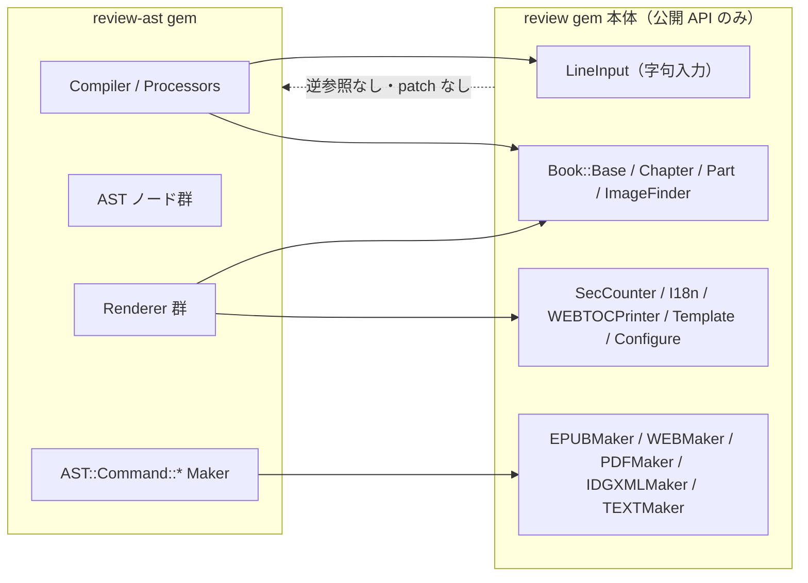
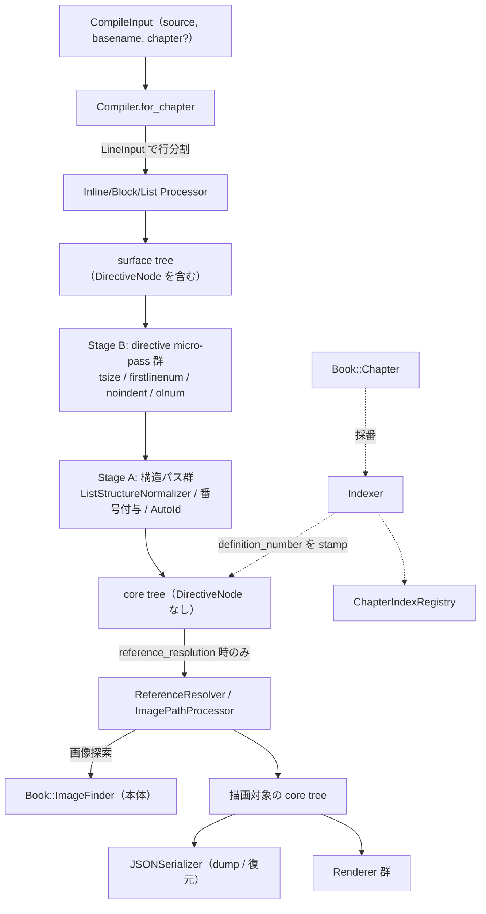
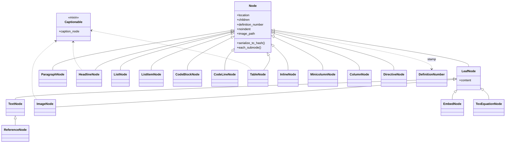
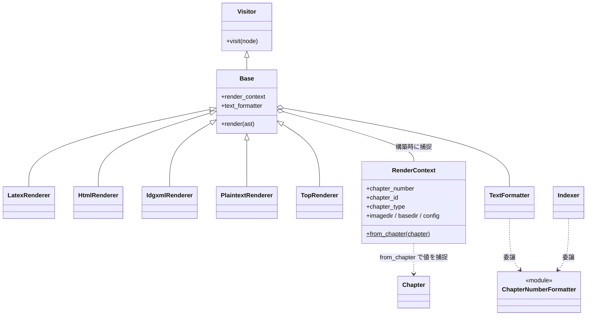
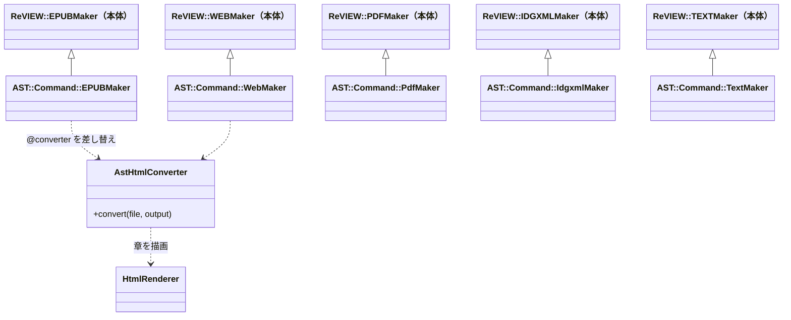

# review-ast アーキテクチャ

本書は review-ast の全体構造と、Re:VIEW 本体(released gem `review`)との関係を
図で整理する。AST の意味論そのものは `doc/ast-semantics.ja.md`、個々の設計判断は
`doc/design-improvements.ja.md` を参照。ここでは「どのクラスが何を担い、本体とどこで
接するか」に絞る。

## 1. 全体像: 本体と review-ast の関係

review-ast は本体 `review` gem とは別の gem であり、本体の公開 API だけに依存する。
本体クラスへの monkey patch は 0 件(かつて `core_ext.rb` にあった追加フックはファイル
ごと削除済み)、本体から review-ast への逆参照も 0 件である。依存は一方向:
review-ast → 本体。

貫く一般則は「契約に現れるデータ型は所有し、契約に現れないサービスは再利用する」。
AST として外部に見える型(ノード、番号、パス、コンテキスト)は review-ast が所有し、
環境依存のサービス(字句入力、画像探索、ロケール、テンプレート、組版・梱包)は本体を
再利用する。

## 2. 本体との界面(3つの狭い接点)

本体との接触はコード全体でも次の3箇所に集約されている。

| 接点 | 使う本体 | review-ast 側の窓口 | 役割 |
|---|---|---|---|
| コンパイル入口 | `ReVIEW::LineInput` | `CompileInput` → `Compiler` | ソース文字列を行入力へ流す(字句解析自体は AST 独自実装) |
| レンダラ入力 | `Book::Chapter`(サービスハンドル) | `RenderContext` | 章番号/id/型/パス/config を値として捕捉し、renderer は本体オブジェクトに触れない |
| maker 層 | 本体 maker(継承)+ `ImageFinder` 等 | `AST::Command::*Maker` + `AstHtmlConverter` | 梱包・組版は本体を継承し、章の描画だけ AST に差し替える |

これ以外(番号付け、参照解決、画像パス解決)は AST 内で完結し、結果をノードへ stamp
する。

## 3. コンパイルパイプライン

`Compiler#compile_to_ast(input)` は `CompileInput`(ソース + サービスハンドル)を受け、
surface tree → lowering → core tree の順に木を作る。参照解決・画像パス解決はフルビルド
時のみ走る別フェーズ。

Indexer は番号付き定義(`//list`/`//image`/… 、脚注)を採番して `definition_number` を
ノードへ stamp し、参照解決用の `ChapterIndexRegistry` を作る。レガシー
`ReVIEW::Book::*Index` はもう構築しない。

## 4. ノードモデル

すべてのノードは `Node` を基底とし、子を持たない内容ノードは `LeafNode` を経由する。
シリアライズは各ノードの `serialize_properties` / `deserialize_from_hash` に一元化され
(かつての `to_h` 系は撤去)、横断的フィールド(`definition_number` / `noindent` /
`image_path`)は基底が付与する。

型判別子(`inline_type` / `code_type` / `table_type` / `minicolumn_type` など)は
コンストラクタで Symbol に正規化され、fresh コンパイルと deserialize で表現が一致する。

## 5. レンダラ

各 renderer は `ReVIEW::AST::Visitor` を継承し、core tree を訪問して形式別文字列を作る。
本体オブジェクトには触れず、章由来の値は `RenderContext` から、番号整形は
`TextFormatter` → `ChapterNumberFormatter` から得る。

`RenderContext.from_chapter(chapter)` が `Book::Chapter` から number/id/型/パス/config を
一度だけ捕捉するので、renderer は live な本体オブジェクトを保持しない。番号整形の分類は
`RenderContext.chapter_type`、整形本体は `ChapterNumberFormatter`(AST 中立)で、
compile 側(Indexer)と render 側(TextFormatter)が共有する。

## 6. maker 層(出力生成)

出力(EPUB/Web/PDF/IDGXML/Text)は、本体 maker を継承し「converter(章 → 出力ファイル)
だけを AST 描画へ差し替える」形で作る。梱包・組版・目次・画像コピー等は本体を再利用する。

EPUB/Web は `@converter` を `AstHtmlConverter`(本体 `ReVIEW::Converter` と同じ
`convert(file, output)` 界面)へ差し替えるだけで、`HtmlRenderer` のフルページ描画に
切り替わる。PDF/IDGXML/Text も同型で対応する renderer に差し替える。EPUB の OPF/NCX、
Web のサイドバー目次(`WEBTOCPrinter`/`WebTocBuilder`)などの梱包は本体側のまま。

## 7. 界面の総括: 再利用するサービス / 所有するデータ型

| 分類 | 対象 | 理由 |
|---|---|---|
| 本体を再利用(サービス) | `LineInput` | 字句入力の口。字句解析自体は AST 独自 |
| 〃 | `Book::Base`/`Chapter`/`Part`/`ImageFinder` | ソース内容・catalog 所属・画像探索(環境依存) |
| 〃 | `SecCounter` / `I18n` / `WEBTOCPrinter` / `Template` / `Configure` | 採番アンカー・ロケール・目次・ERB・設定 |
| 〃 | `EPUBMaker`/`WEBMaker`/`PDFMaker`/`IDGXMLMaker`/`TEXTMaker` | 梱包・組版のオーケストレーション |
| review-ast が所有(データ型) | `Node` 階層 | AST 契約の本体。JSON で外部へ出る |
| 〃 | `CompileInput` | コンパイル入口の契約(source + メタデータ + サービスハンドル) |
| 〃 | `RenderContext` | レンダラ入力の契約(章の値の束) |
| 〃 | `DefinitionNumber` / `ChapterIndexRegistry` / `ChapterNumberFormatter` | 番号と番号整形(AST 所有・中立) |
| 〃 | `JSONSerializer` | ダンプ形式(`ast_format` 版付き) |

この線引き(データは所有、サービスは再利用)により、review-ast は本体を patch せず、
本体は review-ast を知らないまま、両者が released gem の公開 API だけで噛み合う。
